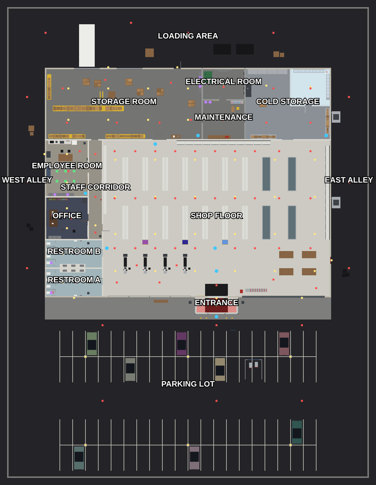
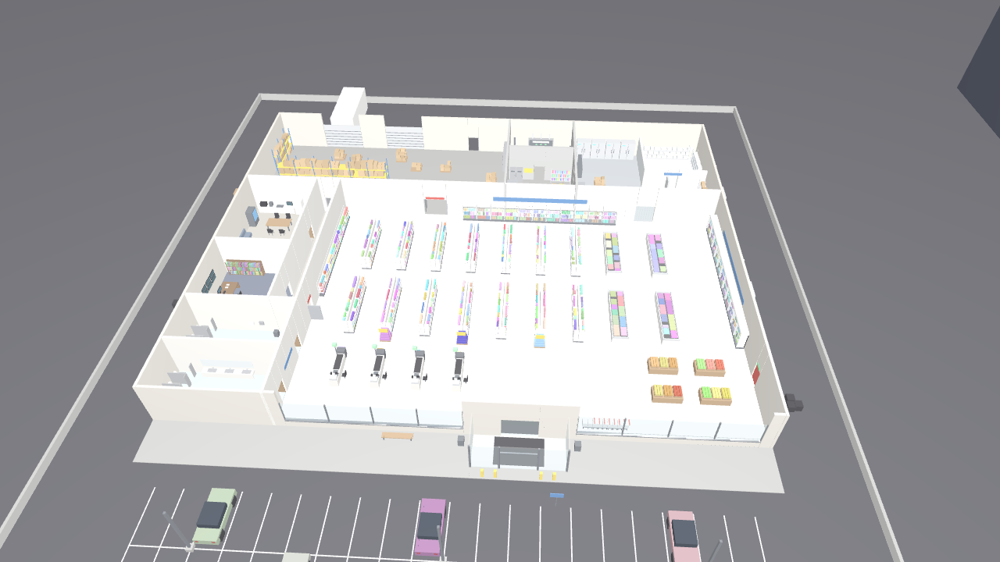
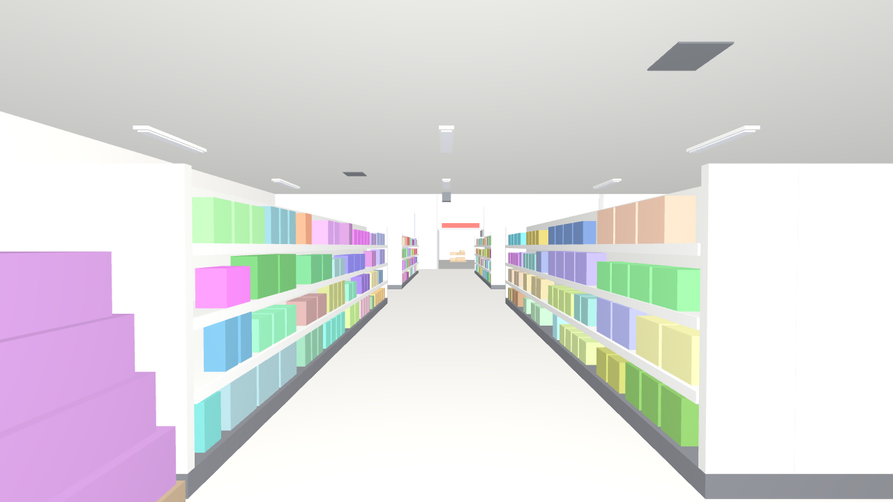
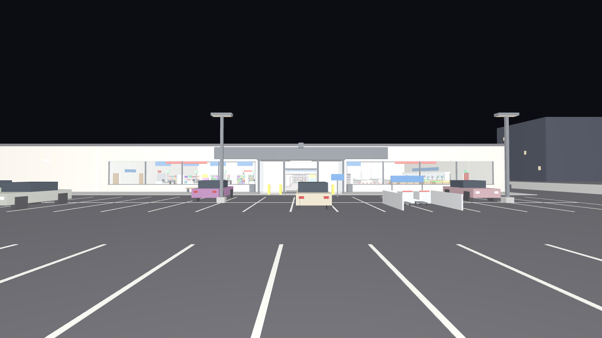

# Fase 3 — Ambiente

Estado: **implementado, à espera do teu teste no Studio.** Build `0.3.0`.

O supermercado existe: um edifício completo, com parque de estacionamento, que podes percorrer a
pé. É um *greybox* — a geometria, as dimensões e a disposição são as definitivas, mas é tudo feito
de blocos simples, sem texturas nem modelos detalhados. Ainda não há jogabilidade (tarefas,
monstro, portas interativas): isso começa na Fase 4.

Vistas esquemáticas, geradas pela minha ferramenta a partir das mesmas peças. **Não são capturas do
Roblox**: no Studio é de noite, com a iluminação e os materiais reais, e os letreiros têm texto.

| | |
|---|---|
|  |  |
|  | |

---

## 1. Como abrir

1. Descarrega `releases/NightShiftSupermarket.rbxl` (do GitHub, ou o ficheiro que te envio).
2. Abre-o no Roblox Studio e carrega em **Play** (F5).

Apareces na sala dos funcionários. O ficheiro contém o mapa **e** o código, por isso substitui o
ficheiro de pré-visualização da Fase 2.

> **Não edites à mão o que está em `Workspace.Map`.** Essa pasta é gerada: cada build novo
> substitui-a inteira. Se quiseres acrescentar algo teu no Studio, diz-me primeiro — combinamos
> uma pasta à parte que os builds não tocam.

---

## 2. O que foi construído

Dimensões em studs (uma personagem tem cerca de 5 de altura). O edifício tem 200 × 160.

| Área | O que tem |
|---|---|
| **Loja** (160 × 110) | 7 gôndolas em duas filas com corredor transversal, prateleiras na parede oeste, 120 secções de prateleira com produtos variados por categoria, 11 frigoríficos de laticínios, 11 de congelados, 4 arcas, 4 caixas registadoras com tapete, leitor, ecrã e cadeira, mesas de fruta, pilhas promocionais, carrinhos, cestos, letreiros de corredor, faixas suspensas, saídas de ar |
| **Entrada** | Portas de vidro de correr interiores e exteriores (trancadas durante a noite), vestíbulo envidraçado, tapetes, montras para o parque |
| **Armazém** | Estantes industriais com caixas, paletes, porta-paletes, 2 cais de carga, porta das traseiras, cacifos, secretária de receção |
| **Manutenção** | Bancada, painel de ferramentas, estante de produtos de limpeza, balde e esfregona, caixa de lâmpadas, cacifos |
| **Sala elétrica** | Quadro geral, 5 disjuntores (Shop, BackOfHouse, Cold, Staff, Exterior), gerador |
| **Câmara fria** | 4 frigoríficos industriais, compressor, estantes, câmara de congelação com porta |
| **Corredor do pessoal** | Liga a loja, o escritório, a sala dos funcionários e o armazém |
| **Escritório** | Secretária, computador, parede de 6 monitores de segurança, arquivos, estante, cofre |
| **Sala dos funcionários** | Mesa e cadeiras, balcão com micro-ondas e máquina de café, frigorífico, máquina de bebidas, sofá, cacifos, quadro de avisos, relógio de ponto, pontos de spawn |
| **Casas de banho** (2) | 4 cabines cada, lavatórios, espelho, secador de mãos |
| **Parque** | 80 lugares marcados, 8 carros, 6 candeeiros, recolha de carrinhos, letreiro da loja, passeio |
| **Traseiras e becos** | Reboque no cais, contentores do lixo, paletes, unidades de ar condicionado; dá a volta completa ao edifício |
| **Mundo exterior** | Muro baixo com barreira invisível, estrada, edifícios escuros ao longe |

A loja chama-se **HOLLOWAY'S MARKET** (muda-se em `map/Layout.luau`).

### Circulação
Há três circuitos fechados, para que uma perseguição nunca termine num beco sem saída por
desenho: loja ↔ armazém ↔ corredor do pessoal; loja ↔ câmara fria ↔ manutenção ↔ armazém; e a
volta exterior ao edifício pela porta das traseiras. Salas sem segunda saída (escritório, sala
dos funcionários, casas de banho, sala elétrica, congelador) têm esconderijos ou são objetivos.

### Luz
63 luzes: 24 na loja, 8 no armazém (mais esparsas e esverdeadas), tom quente na sala dos
funcionários, frio na câmara fria, 6 candeeiros no parque. Cada luz sabe a que zona e a que
circuito elétrico pertence; algumas estão marcadas para tremeluzir mais tarde. A sala elétrica
está num circuito de emergência, para o quadro poder ser sempre encontrado às escuras.

### O que o código do jogo vai encontrar no mapa
Tudo o que é interativo ou serve de referência está marcado com tags
(`src/shared/Config/Tags.luau`): 16 zonas, 75 pontos de patrulha, 25 pontos para clientes,
8 câmaras de segurança, 14 portas, 120 secções de prateleira, 30 unidades de frio, 9 esconderijos,
19 pontos de derrame, 13 de lixo, 9 de carrinhos abandonados, 3 de entregas, 6 spawns, quadro
elétrico, disjuntores, computador do escritório, relógio de ponto, ferramentas.

---

## 3. Lista de verificação no Studio

- [ ] O ficheiro abre e o Play arranca sem linhas vermelhas no Output.
- [ ] `[NSS/Server/Main] Server ready (build 0.3.0, …)` e `Client ready (build 0.3.0, …)`.
- [ ] Apareces na sala dos funcionários (mesa, cacifos, máquina de bebidas).
- [ ] Consegues ir a pé a todo o lado: corredor → loja → todos os corredores → caixas →
      casas de banho → armazém → manutenção → sala elétrica → câmara fria → congelador →
      escritório.
- [ ] Consegues sair pela **porta das traseiras** (no armazém, parede norte) e dar a volta ao
      edifício até ao parque de estacionamento.
- [ ] Não atravessas paredes, prateleiras nem frigoríficos, e não ficas preso em lado nenhum.
- [ ] Não cais para fora do mundo e não consegues passar o muro exterior.
- [ ] Os letreiros leem-se (corredores, STAFF ONLY, EXIT, nome da loja na fachada).

E quero a tua opinião sobre três coisas que só se veem no Studio:

1. **Luz:** a loja está demasiado escura, demasiado clara, ou bem para "meia-noite, tudo normal"?
2. **Escala:** o edifício parece grande demais, pequeno demais, ou bem?
3. **Algo que falte ou esteja a mais** em alguma área.

Um ecrã ou dois tirados no Studio ajudam-me muito, porque eu não consigo ver o resultado real.

### Esperado nesta fase (não são erros)
- As portas estão todas abertas e não se mexem; a saída de emergência e a entrada estão fechadas.
- Os produtos são blocos e cilindros coloridos; os carros e os móveis são caixas.
- O vestíbulo da entrada não é acessível (está trancado durante a noite, por desenho).
- As cabines das casas de banho são estreitas.

---

## 4. Como o mapa é feito

O mapa não é desenhado à mão no Studio: é gerado por código em `map/` e gravado no ficheiro do
place por `tools/build.luau`. Para mudar a planta, muda-se o código e volta-se a construir —
fica tudo no histórico do Git e nunca há dois sítios com versões diferentes.

| Ficheiro | Conteúdo |
|---|---|
| `map/Layout.luau` | Todas as divisões e as suas medidas; nome da loja; categorias dos corredores |
| `map/Palette.luau` | Cores e materiais |
| `map/Kit.luau` | Peças base: caixas, paredes com aberturas, portas, luzes, texto |
| `map/Structure.luau` | Chão, paredes, tetos, telhado, portas, montras, entrada |
| `map/Shop.luau` | Corredores, produtos, frio, caixas, zona da frente, letreiros |
| `map/Rooms.luau` | Armazém, manutenção, sala elétrica, câmara fria, corredor, escritório, sala dos funcionários, casas de banho |
| `map/Exterior.luau` | Parque, traseiras, becos, limites, mundo ao longe |
| `map/Markers.luau` | Luzes de teto, zonas, navegação, pontos de tarefas, câmaras, spawns |

O gerador usa uma semente fixa, por isso cada build produz exatamente o mesmo mapa.

---

## 5. O que eu verifiquei — e o que não verifiquei

**Verificado aqui** (`./scripts/check.sh`, que agora também constrói o place):
- O ficheiro é gerado e volta a ler-se corretamente: mapa, scripts, iluminação base, spawns.
- **Caminhabilidade:** simulei uma personagem (2 studs de largura, 5 de altura) numa grelha de
  1 stud. A partir do spawn chega-se a pé aos 75 pontos de patrulha, a todos os pontos de
  clientes e de tarefas, e a menos de 6 studs de todos os objetos interativos.
- Cada zona tem ponto de patrulha; cada zona interior tem luz; as 8 câmaras existem.
- Fechei duas portas de propósito: a verificação detetou 319 pontos inacessíveis e recusou gravar.
- Vi a planta e oito vistas 3D esquemáticas para confirmar paredes, alturas e tetos.

**Não verificado — só o Studio pode confirmar:**
- O aspeto real: iluminação, materiais, névoa, legibilidade dos letreiros.
- O desempenho (4734 peças, 63 luzes, 21 delas com sombras). Deve correr bem em PC; telemóvel
  fica para a fase de testes.
- A simulação de caminhabilidade aproxima a personagem a uma caixa. Um canto onde o Roblox
  prenda a personagem pode ter-me escapado.
- A malha de navegação do Roblox (usada pelo monstro) só existe dentro do Studio.
